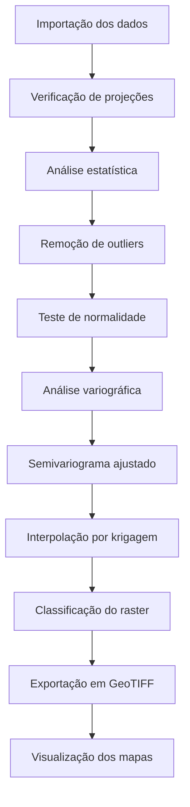
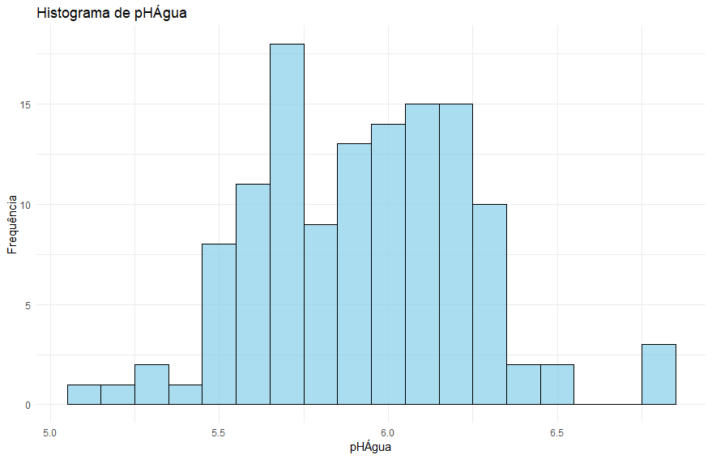
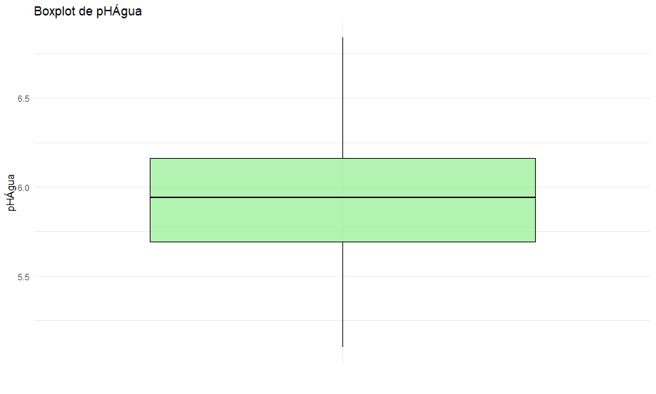
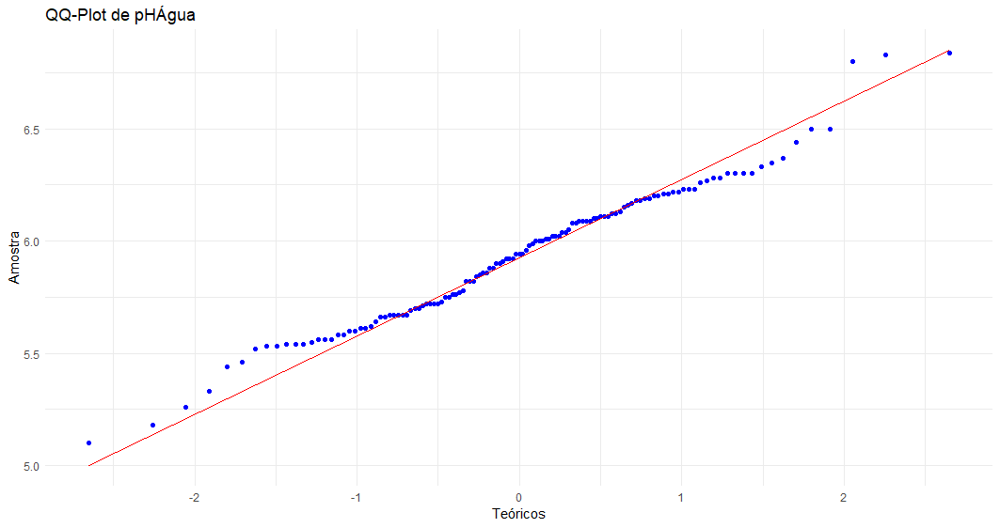
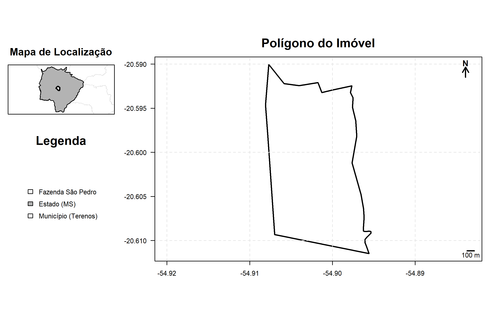

# Projeto de análise espacial e interpolação por krigagem

Este repositório reúne a implementação de uma análise estatística e geoestatística aplicada ao parâmetro pH da água. O objetivo principal é avaliar a distribuição espacial dos dados, identificar padrões e gerar um modelo de interpolação por krigagem para representar a continuidade espacial da variável ao longo da área de estudo.

A rotina de processamento inclui a importação de camadas espaciais, verificação de projeções, análise exploratória, avaliação de outliers, teste de normalidade, ajuste do semivariograma e geração de mapas finais em formato raster e visualizações gráficas.

## Estrutura do projeto

- imovel/: arquivos shapefile utilizados na análise, incluindo o limite da área de estudo e os pontos de coleta.
- localizacao/: camadas geográficas auxiliares, como limites municipais e estaduais, empregadas para contextualização espacial.
- saida/: diretório de resultados, contendo gráficos, mapas e o raster interpolado.
- analise_estatistica_pH_agua.R: script principal responsável pela análise estatística e geoestatística.

## Objetivo da análise

A análise foi conduzida para:

- descrever a distribuição dos valores de pH da água;
- verificar a presença de outliers e possíveis desvios de distribuição;
- testar a normalidade dos dados;
- modelar a dependência espacial por meio de semivariograma;
- interpolar os valores em toda a área por krigagem;
- exportar o resultado em GeoTIFF e produzir mapas de apoio à interpretação espacial.

## Fluxo de trabalho

### Descrição das etapas

- A Importação dos dados: leitura das camadas geoespaciais necessárias para a análise, incluindo o limite da área e a base de pontos.
- B Verificação de projeções: validação da compatibilidade entre os sistemas de referência espacial das camadas.
- C Análise estatística: cálculo de medidas descritivas e avaliação inicial da distribuição dos dados.
- D Remoção de outliers: identificação e exclusão de observações que possam distorcer os resultados.
- E Teste de normalidade: aplicação de procedimentos estatísticos para verificar a aderência à distribuição normal.
- F Análise variográfica: construção do semivariograma experimental para estimar a dependência espacial.
- G Semivariograma ajustado: ajuste de um modelo teórico ao semivariograma experimental.
- H Interpolação por krigagem: geração de um raster interpolado a partir dos valores observados.
- I Classificação do raster: segmentação dos valores em classes para facilitar a interpretação espacial.
- J Exportação em GeoTIFF: armazenamento do resultado interpolado em formato geoespacial.
- K Visualização dos mapas: produção de gráficos e mapas finais para apresentação dos resultados.

## Visualizações

### Histogramas e boxplots

### Resultado da krigagem

### Semivariograma ajustado

### Mapa de localização

## Estatísticas

A análise inclui a seguinte estrutura de avaliação:

- Teste de normalidade (Shapiro-Wilk): cálculo da estatística e do valor p.
- Estatísticas descritivas:
  - média;
  - desvio padrão;
  - mediana;
  - valor mínimo e máximo;
  - assimetria;
  - curtose.

Esses indicadores permitem verificar a dispersão dos dados, a tendência central e a forma da distribuição antes da interpolação.

## Ferramentas e bibliotecas

A análise foi desenvolvida em linguagem R, utilizando bibliotecas específicas para manipulação de dados espaciais e modelagem geoestatística.

- R: ambiente computacional para processamento estatístico e espacial.
- sf: manipulação de dados espaciais vetoriais.
- dplyr: transformação e organização dos dados.
- ggplot2: geração de visualizações gráficas.
- gstat: análise variográfica e interpolação por krigagem.
- raster: leitura, manipulação e exportação de rasters.

## Licença

Este projeto é distribuído sob a licença MIT. Consulte o arquivo LICENSE para mais informações.
