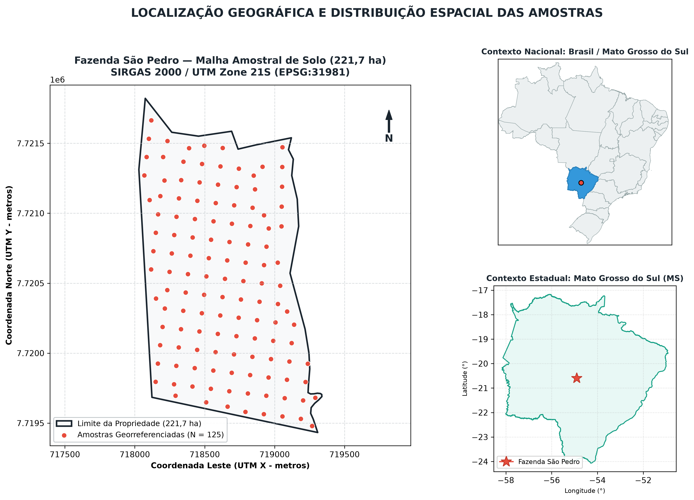
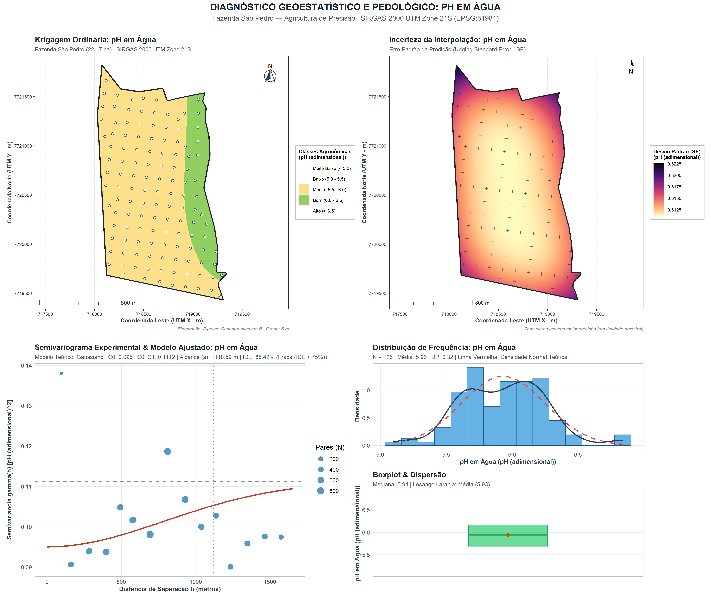
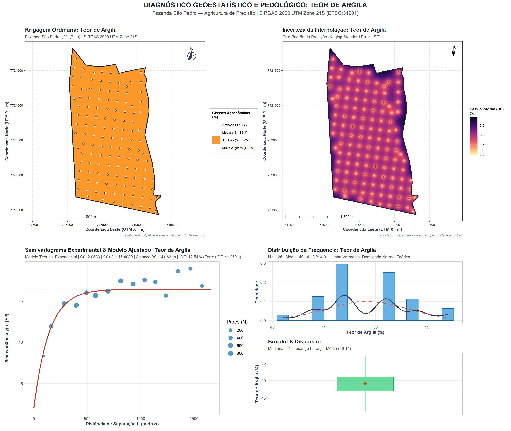
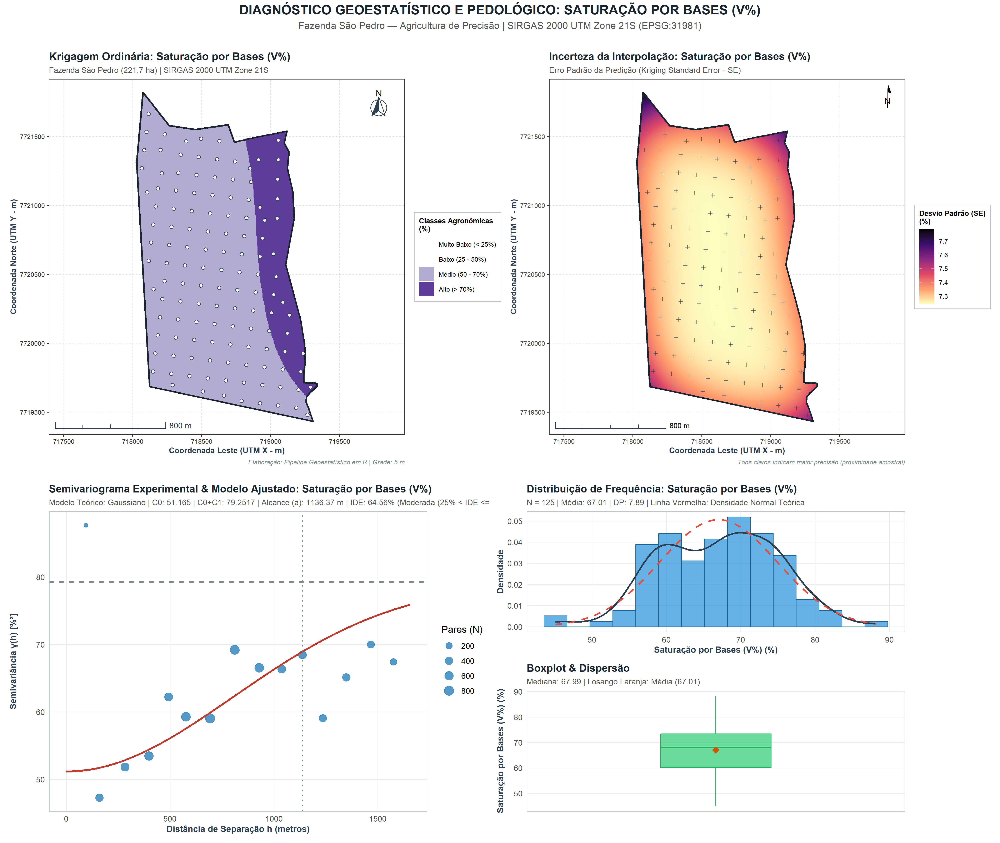
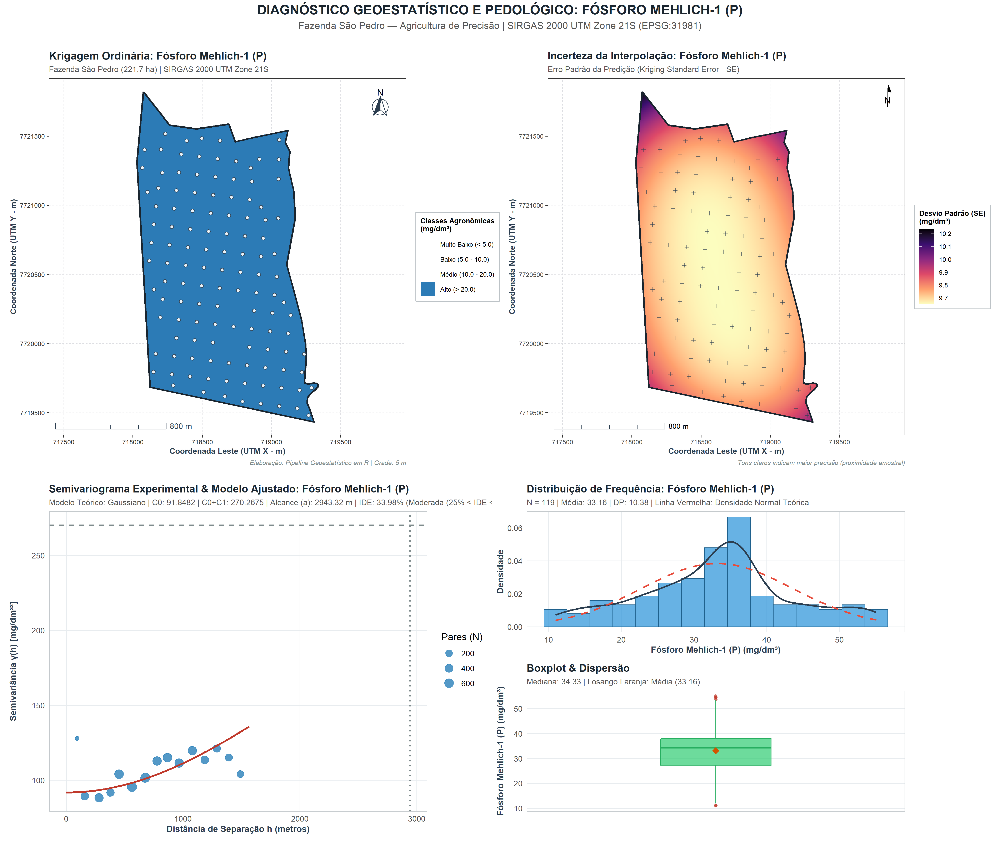
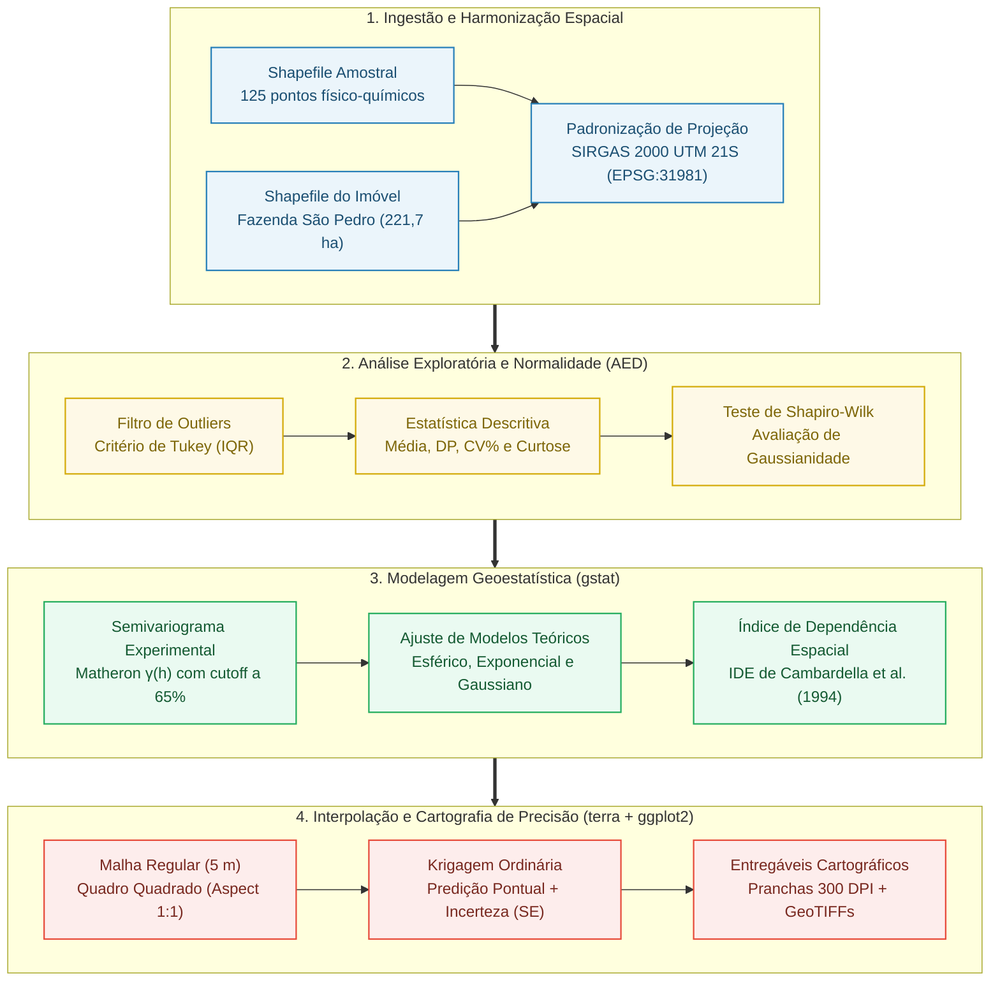

# Geoestatística e Variabilidade Espacial da Fertilidade do Solo em R

[](https://www.r-project.org/)
[](https://r-spatial.github.io/sf/)
[](https://www.ibge.gov.br/)
[](https://www.embrapa.br/solos)
[](LICENSE)

Pipeline automatizado em **Linguagem R** para análise exploratória de dados (AED), modelagem variográfica, seleção automática de modelos teóricos (Esférico, Exponencial, Gaussiano) e interpolação contínua por **Krigagem Ordinária** de atributos físico-químicos e granulométricos do solo em área de agricultura de precisão (221,7 hectares, Fazenda São Pedro / MS).

O projeto unifica rigor matemático geoestatístico (cálculo de **IDE de Cambardella**, alcance prático $a$, efeito pepita $C_0$ e variância de predição/incerteza amostral) com padrões modernos de desenvolvimento em R (`sf`, `terra`, `gstat`, `patchwork`, `ggspatial`) e entrega cartográfica em **300 DPI**.

<p align="center">
  
</p>
<p align="center">
  <em>Prancha Executiva Integrada (300 DPI): Superfície Interpolada e Classes Agronômicas (Top-Left), Incerteza Amostral / Erro Padrão SE (Top-Right), Semivariograma com Ajuste Teórico (Bottom-Left) e Diagnóstico Exploratório de Normalidade (Bottom-Right).</em>
</p>

---

## 1. Destaques Técnicos do Repositório

* **Arquitetura Modular Desacoplada (`src/`):** Separação estrita de responsabilidades entre configuração (`config.R`), exploração e normalidade (`eda_soil.R`), variografia (`variography.R`), interpolação geoestatística (`kriging_engine.R`) e renderização cartográfica (`cartography.R`).
* **Suporte Multi-Variável Extensível:** Processamento unificado para $pH$ em Água, Teor de Argila (granulometria), Saturação por Bases ($V\%$), Fósforo Mehlich-1 ($P$) e Matéria Orgânica ($MO$), com calibração das classes agronômicas oficiais segundo a **SBCS / EMBRAPA**.
* **Seleção Automatizada do Melhor Modelo Teórico:** Ajuste concorrente de modelos Esférico, Exponencial e Gaussiano com seleção pelo critério de Mínimos Quadrados Ponderados (menor $SSErr$) e cálculo formal do **Índice de Dependência Espacial (IDE)**.
* **Mapeamento de Incerteza da Krigagem (Kriging Standard Error):** Ao contrário de interpolações determinísticas (IDW, Spline), o pipeline calcula e mapeia o desvio-padrão da predição ($\sigma_{OK}$), evidenciando a confiabilidade espacial de cada setor da propriedade.
* **Saídas em Alta Definição (300 DPI):** Exportação direta de pranchas executivas integradas ($4800 \times 3600\text{ px}$), mapas individuais com grades de coordenadas UTM formatadas, rosa dos ventos e escala gráfica, além de matrizes raster GeoTIFF para integração em SIGs de cabine (QGIS, John Deere Operations Center, Climate FieldView).

---

## 2. Localização da Área e Grade Amostral

A malha amostral compreende **125 pontos georreferenciados** distribuídos em grade regular sobre 221,7 hectares de lavoura comercial (densidade de $\approx 1$ amostra a cada 1,77 ha), situada no domínio do bioma Cerrado/Pantanal em Mato Grosso do Sul, projetada em **SIRGAS 2000 / UTM Zone 21S (EPSG:31981)**:

<p align="center">
  
</p>

---

## 3. Galeria de Pranchas Executivas Geradas (300 DPI)

O pipeline consolida os quatro quadrantes analíticos da ciência de dados de solo: **(1) Superfície Interpolada e Classes Agronômicas**, **(2) Mapa de Incerteza Amostral / Desvio Padrão**, **(3) Semivariograma Experimental e Curva Teórica**, e **(4) Diagnóstico de Distribuição (Histograma, Boxplot e Normalidade)**.

### A) Acidez Ativa do Solo — $pH$ em Água
Apresenta distribuição normal ($p = 0.102$), média de 5,93 e amplitude entre 5,10 e 6,84, com dependência espacial modelada por curva Gaussiana e alcance de 1.118 metros:
<p align="center">
  
</p>

### B) Granulometria — Teor de Argila (%)
Apresenta **forte dependência espacial** ($IDE = 12,54\%$) ajustada ao modelo Exponencial, com alcance prático de 141,6 metros e teor médio de 49,14% (textura argilosa uniforme em grande parte do imóvel):
<p align="center">
  
</p>

### C) Fertilidade Química — Saturação por Bases ($V\%$)
Indicador fundamental para recomendação de calagem. Exibe média de 67,0% ($CV = 11,77\%$), distribuição normal ($p = 0.279$) e ajuste Gaussiano com alcance de 1.136 metros:
<p align="center">
  
</p>

### D) Fósforo Disponível — $P$ Mehlich-1 ($mg/dm^3$)
Atributo com variabilidade média ($CV = 31,29\%$, conforme Warrick & Nielsen 1980), modelado por curva Gaussiana com $IDE = 33,98\%$ (dependência espacial moderada):
<p align="center">
  
</p>

---

## 4. Síntese dos Resultados Pedológicos e Geoestatísticos

### Diagnóstico Descritivo e Teste de Normalidade (Shapiro-Wilk)

| Atributo | Unidade | N | Outliers | Média | Desvio Padrão | CV (%) | Classe de Variabilidade | Shapiro-Wilk (W) | p-valor | Distribuição |
| :--- | :---: | :---: | :---: | :---: | :---: | :---: | :---: | :---: | :---: | :---: |
| **pH em Água** | - | 125 | 0 | 5,93 | 0,32 | 5,36% | Baixa ($CV \le 12\%$) | 0,9823 | 0,1020 | Normal ($p > 0,05$) |
| **Argila** | % | 125 | 0 | 49,14 | 4,01 | 8,15% | Baixa ($CV \le 12\%$) | 0,9248 | 0,0000 | Não-Normal ($p \le 0,05$) |
| **Saturação por Bases ($V\%$)** | % | 125 | 0 | 67,01 | 7,89 | 11,77% | Baixa ($CV \le 12\%$) | 0,9870 | 0,2792 | Normal ($p > 0,05$) |
| **Matéria Orgânica ($MO$)** | $g/dm^3$ | 124 | 1 | 35,98 | 3,42 | 9,51% | Baixa ($CV \le 12\%$) | 0,9784 | 0,0442 | Não-Normal ($p \le 0,05$) |
| **Fósforo ($P$)** | $mg/dm^3$ | 119 | 6 | 33,16 | 10,38 | 31,29% | Média ($12\% < CV \le 60\%$) | 0,9767 | 0,0365 | Não-Normal ($p \le 0,05$) |

> **Nota:** Classificação do Coeficiente de Variação ($CV$) estabelecida segundo os limites clássicos de *Warrick & Nielsen (1980)*: Baixa ($CV \le 12\%$), Média ($12\% < CV \le 60\%$) e Alta ($CV > 60\%$).

### Modelagem Variográfica e Dependência Espacial

O Índice de Dependência Espacial ($IDE$) segue o critério consagrado de *Cambardella et al. (1994)*:
$$IDE = \left( \frac{C_0}{C_0 + C_1} \right) \times 100$$

| Atributo | Modelo Teórico | Efeito Pepita ($C_0$) | Contribuição ($C_1$) | Patamar ($C_0 + C_1$) | Alcance Prático ($a$) | $IDE$ (%) | Grau de Dependência Espacial |
| :--- | :---: | :---: | :---: | :---: | :---: | :---: | :---: |
| **Argila** | Exponencial | 2,058 | 14,351 | 16,409 | 141,6 m | 12,54% | **Forte** ($IDE \le 25\%$) |
| **Fósforo ($P$)** | Gaussiano | 91,848 | 178,419 | 270,268 | 2.943,3 m | 33,98% | **Moderada** ($25\% < IDE \le 75\%$) |
| **Saturação por Bases ($V\%$)** | Gaussiano | 51,165 | 28,087 | 79,252 | 1.136,4 m | 64,56% | **Moderada** ($25\% < IDE \le 75\%$) |
| **pH em Água** | Gaussiano | 0,095 | 0,016 | 0,111 | 1.118,6 m | 85,42% | **Fraca** ($IDE > 75\%$) |
| **Matéria Orgânica ($MO$)** | Esférico | 10,769 | 0,621 | 11,390 | 513,6 m | 94,55% | **Fraca** ($IDE > 75\%$) |

---

## 5. Arquitetura e Fluxo do Pipeline



---

## 6. Estrutura do Repositório

```text
analise_solo_r/
├── analise_solo_r.Rproj       # Arquivo de projeto do RStudio (raiz imediata)
├── .gitignore                 # Regras de exclusão para R, RStudio, GIS e OS
├── LICENSE                    # Licença permissiva MIT
├── README.md                  # Documentação técnica oficial e showcase
├── run_analysis.R             # Script mestre amigável para execução imediata
├── demo/                      # Imagens de demonstração para o README (300 DPI)
├── data/
│   ├── raw/                   # Shapefiles de amostragem e limite da propriedade
│   │   ├── Analise_solo_completo.*
│   │   └── area_imovel_utm.*
│   └── context/               # Shapefiles de apoio territorial (Estados do Brasil)
│       └── BRASIL_ESTADOS.*
├── src/
│   ├── config.R               # CRS, variáveis, parâmetros de krigagem e paletas
│   ├── eda_soil.R             # Análise exploratória, remoção de outliers e Shapiro-Wilk
│   ├── variography.R          # Ajuste concorrente de semivariogramas e cálculo do IDE
│   ├── kriging_engine.R       # Malha regular de 5m, Krigagem Ordinária e rasters terra
│   ├── cartography.R          # Motor gráfico de pranchas integradas em 300 DPI
│   └── pipeline.R             # Orquestrador ponta a ponta univariado e em lote
└── outputs/
    ├── figures/               # Pranchas executivas e mapas temáticos (300 DPI, PNG)
    ├── rasters/               # GeoTIFFs interpolados (estimativa, incerteza e classes)
    └── tables/                # Resumos estatísticos e geoestatísticos consolidados em CSV
```

---

## 7. Como Executar

### Pré-requisitos
* **R (versão $\ge 4.0$)** instalado no sistema.
* **RStudio** (recomendado para exploração interativa).

### Instalação de Dependências
Abra o R ou o console do RStudio e instale os pacotes requeridos:

```r
install.packages(c(
  "sf", "terra", "gstat", "ggplot2", "dplyr", 
  "patchwork", "viridis", "ggspatial", "scales", "psych", "here"
))
```

### Execução via RStudio
1. Abra o arquivo [`analise_solo_r.Rproj`](file:///analise_solo_r.Rproj) no RStudio.
2. Abra e execute [`run_analysis.R`](file:///run_analysis.R):
   ```r
   source("run_analysis.R")
   ```

### Execução via Terminal / Linha de Comando
```bash
# Execução direta do script mestre
Rscript run_analysis.R

# Ou execução em lote de todas as variáveis
Rscript -e "source(here::here('src', 'pipeline.R')); run_all_soil_variables()"
```

Todos os mapas em 300 DPI serão gravados em `outputs/figures/`, os rasters GeoTIFF em `outputs/rasters/` e as tabelas resumidas em `outputs/tables/`.

---

## 8. Referências Bibliográficas

* **CAMBARDELLA, C. A. et al.** (1994). *Field-scale variability of soil properties in central Iowa soils*. Soil Science Society of America Journal, v. 58, n. 5, p. 1501-1511.
* **EMBRAPA.** (2018). *Sistema Brasileiro de Classificação de Solos*. 5. ed. Brasília: Embrapa.
* **MATHERON, G.** (1963). *Principles of geostatistics*. Economic Geology, v. 58, n. 8, p. 1246-1266.
* **SBCS.** (2016). *Manual de Calagem e Adubação para os Estados do Rio Grande do Sul e de Santa Catarina*. Comissão de Química e Fertilidade do Solo - RS/SC.
* **WARRICK, A. W.; NIELSEN, D. R.** (1980). *Spatial variability of soil physical properties in the field*. In: HILLEL, D. (Ed.). Applications of soil physics. New York: Academic Press, p. 319-344.

---

## 📜 Licença

Distribuído sob a licença **MIT**. Consulte [`LICENSE`](LICENSE) para mais informações.
